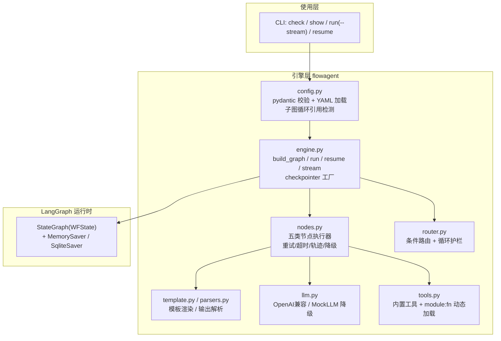

# flowagent 技术文档 —— 配置驱动的 LangGraph 工作流智能体

> 版本 0.8.0 ｜ Python 3.12 ｜ langgraph 1.2.11 ｜ 测试：pytest 259 用例，覆盖率 96%+
>
> 0.2.0：human 人工介入、workflow 子图、节点重试/超时、checkpointer、CLI check/resume/--stream。
> 0.3.0：human 选项与交互式恢复、轨迹导出、事件钩子、工具白名单、子图实例透传、FastAPI 示例。
> 0.4.0：`pip install -e .` 可安装、指数退避、综合示例（子图+HITL+重试+循环）、Dockerfile。
> 0.5.0：静态引用分析（`check --strict` 工作流 linter）、`run --output json`、CI lint。
> 详见 [CHANGELOG](../CHANGELOG.md)。

---

## 1. 项目概述

**flowagent** 是一个**配置驱动**的工作流智能体（Workflow Agent）引擎：
业务流程（节点、提示词、条件路由、并行分支、循环护栏、错误降级、人工介入、子图编排）
全部声明在 YAML 配置中，引擎负责把配置**编译成 LangGraph 状态图**并执行。

| 传统写法 | flowagent 写法 |
| --- | --- |
| 每个 workflow 手写 `add_node/add_edge` | 一份 YAML 声明，引擎动态构图 |
| 流程改动要改代码、改测试 | 改配置即可，`check`/`show` 即时校验与预览 |
| LLM 调用与业务耦合 | 统一 LLM 工厂：真实 API 与 Mock 一键切换 |
| 人工审批自研轮询/挂起 | `human` 节点原生暂停/恢复（LangGraph interrupt） |

---

## 2. 智能体框架调研与选型

### 2.1 主流框架对比（2026-09 调研）

| 维度 | **LangGraph** | LangChain (LCEL) | CrewAI | AutoGen (AG2) | OpenAI Agents SDK |
| --- | --- | --- | --- | --- | --- |
| 编排模型 | 状态图（节点+边+条件边+循环） | 线性链式管道 | 角色扮演多智能体 | 会话式多智能体 | Handoff 移交模型 |
| 流程控制力 | ★★★★★ 确定性控制流+动态分支 | ★★ 无原生循环/路由 | ★★★ 声明式任务流 | ★★ 对话驱动，难精确控制 | ★★★★ 简洁但较固定 |
| 状态持久化 | 内置 checkpointer（断点续跑/时间旅行/HITL 前提） | 弱 | 简单记忆 | 会话内 | 简单 |
| 人工介入（HITL） | 原生 `interrupt()` / `Command(resume)` | 手写 | 有限 | 有限 | 有限 |
| 上手成本 | 中（1-2 周） | 低 | 低（3-5 天） | 低-中 | 低（2-3 天） |
| 典型短板 | 抽象层级低，样板代码多 | 表达力不足 | 精细控制弱 | 扩展性差 | 供应商锁定 |

社区共识：**生产级、需要确定性控制流与故障恢复的工作流编排，LangGraph 是当前事实
标准**；CrewAI 适合快速原型；AutoGen 偏研究；OpenAI Agents SDK 适合简单 GPT 原生移交。

来源：

- [Galileo: AutoGen vs. CrewAI vs. LangGraph vs. OpenAI AI Agents](https://galileo.ai/blog/autogen-vs-crewai-vs-langgraph-vs-openai-agents-framework)
- [LangChain 官方: Workflows and Agents](https://docs.langchain.com/oss/python/langgraph/workflows-agents)
- [LangChain 官方: Interrupts（HITL 机制）](https://docs.langchain.com/oss/python/langgraph/interrupts)
- [LangChain 官方: Persistence（checkpointer 选型）](https://docs.langchain.com/oss/python/langgraph/persistence)
- [LangChain 官方博客: Making it easier to build human-in-the-loop agents with interrupt](https://www.langchain.com/blog/making-it-easier-to-build-human-in-the-loop-agents-with-interrupt)
- [Particula Tech: LangGraph vs CrewAI vs OpenAI Agents SDK](https://particula.tech/blog/langgraph-vs-crewai-vs-openai-agents-sdk-2026)
- [Pickaxe: CrewAI vs LangGraph vs AutoGen (2026)](https://pickaxe.co/post/crewai-vs-langgraph-vs-autogen)
- [langgraph-checkpoint-sqlite (PyPI)](https://pypi.org/project/langgraph-checkpoint-sqlite/)
- [社区讨论: LangGraph HITL 的节点二次执行问题](https://www.reddit.com/r/LangChain/comments/1rv2vs8/langgraphs_humanintheloop_has_a_double_execution/)

### 2.2 代码式引擎 vs 低代码平台

工作流智能体还有另一条产品路线——低代码/可视化平台：

| 维度 | 代码式（LangGraph 系） | n8n | Dify | Coze |
| --- | --- | --- | --- | --- |
| 上手门槛 | 需要编程 | 低（可视化节点） | 低-中 | 最低 |
| 流程表达力 | 任意（图灵完备） | 集成自动化强，复杂智能体逻辑受限 | LLM 应用/RAG 强 | 聊天机器人场景强 |
| 版本管理与测试 | Git/pytest 全套工程实践 | 弱 | 弱 | 弱 |
| 复杂状态/循环/护栏 | 原生 | 有限 | 有限 | 有限 |
| 适用场景 | 需要精确控制、可测试、可演进的业务流程 | 通用自动化与系统集成 | RAG/对话应用快速搭建 | 快速原型 |

结论：低代码平台适合快速搭建标准场景；需要**工程化治理**（版本化、测试、精细控制流、
审计轨迹）的工作流智能体，代码式引擎（本项目的路线）更合适。两者也可组合——本引擎
的 FastAPI 服务示例（`examples/api_server.py`）即可作为平台的一个自定义工具节点。

来源：[开源平台对比 n8n/Dify/LangGraph/Coze](https://jimmysong.io/blog/open-source-ai-agent-workflow-comparison/)、
[LangGraph vs n8n（ZenML）](https://www.zenml.io/blog/langgraph-vs-n8n)、
[n8n vs Dify 2026](https://blog.sandbase.ai/n8n-vs-dify-2026/)、
[Open-Source AI Agent Platforms](https://www.sim.ai/library/open-source-ai-agent-platforms)

### 2.3 选型结论

选定 **LangGraph 1.2.11**：状态图原语与本引擎需求逐项对应；持久化/HITL/时间旅行是
其余框架不具备的原生能力；本引擎把低层 API 封装为配置层，恰好弥补其样板代码多的短板。
LangChain 仅作为运行时依赖（`langchain-openai` 提供 OpenAI 兼容 ChatModel）。

---

## 3. 系统架构



### 3.1 模块职责

| 模块 | 职责 |
| --- | --- |
| `config.py` | YAML/dict → pydantic 校验；引用完整性；子图路径改写与循环引用检测 |
| `state.py` | 全局状态 `WFState` 与 reducer（vars 合并 / trace 追加 / loop_counts / error） |
| `engine.py` | 图编译；run/resume/stream；`make_checkpointer` 工厂；`waiting_on` |
| `nodes.py` | 五类节点执行器：重试、超时、轨迹、执行计数、错误降级、interrupt 直通 |
| `router.py` | 路由规则求值（11 种操作符）+ 循环护栏判定 |
| `template.py` | `{var}`/`{a.b}` 渲染（JSON 花括号安全）；`get_path` 点路径取值 |
| `parsers.py` | LLM 输出解析：text/json/lines/classifier |
| `llm.py` | LLM 工厂：OpenAI 兼容端点或 Mock 降级 |
| `tools.py` | 内置工具与 `module:function` 动态加载 |
| `cli.py` | `check` / `show` / `run` / `resume` 四个子命令 |

### 3.2 状态通道设计（WFState）

```python
class WFState(TypedDict):
    vars:        Annotated[dict, merge_dict]   # 业务变量：节点输出按 key 合并
    trace:       Annotated[list, operator.add] # 执行轨迹：只追加
    loop_counts: Annotated[dict, merge_dict]   # 节点执行计数（循环护栏依据）
    error:       dict                          # 最近一次 on_error 降级的错误信息
```

`vars` 使用自定义合并 reducer——并行分支各自写不同 key 时互不覆盖；状态随
checkpointer 按 `thread_id` 持久化，同 thread 续跑时新输入与历史状态合并。

### 3.3 一次执行的完整链路

1. `WorkflowEngine.run(inputs, thread_id)` 以 `{"vars": inputs}` 初始化并 invoke；
2. 从 `workflow.start` 开始按超级步推进；节点执行器：读 `vars` → 渲染/调工具/调 LLM
   → 解析输出 → 写回增量 + 轨迹 + 计数（失败按 retries 重试、超时中断、最终 on_error 降级）；
3. human 节点调用 `interrupt()`：图暂停，状态落在 checkpointer，CLI 打印问题并返回退出码 3；
4. `resume(value, thread_id)` 以 `Command(resume=value)` 恢复：**节点从头重跑**（LangGraph
   语义，故节点内 interrupt 之前的逻辑必须幂等——本引擎在 interrupt 前只做纯模板渲染）；
5. 条件边按规则求值；`next: END` 或无后继时结束。

---

## 4. 工作流配置规范（YAML）

### 4.1 顶层结构

```yaml
workflow:
  name: customer_service        # 必填
  description: ...              # 可选
  start: classify               # 必填，起始节点
  recursion_limit: 60           # 可选，默认 50
  inputs: [ticket]              # 可选，声明运行时输入（供 check --strict 静态引用分析）

nodes:
  <节点名>:
    type: llm | template | tool | human | workflow   # 必填
    next: ...                   # 必填，流转声明（见 4.3）
    output_key: category        # llm/tool/template 必填；human/workflow 可选
    on_error: {goto: ..., set: {...}}   # 可选，错误降级
    retries: 0                  # 可选，失败重试次数（human 不适用）
    retry_delay: 1.0            # 可选，重试间隔秒
    timeout: 30                 # 可选，单次执行超时秒（human 不适用）
```

### 4.2 五种节点类型

| type | 专用字段 | 行为 |
| --- | --- | --- |
| `llm` | `system`, `prompt`, `parser`, `labels`, `mock_response` | 渲染 prompt → 调 LLM → 解析 → 写 `output_key` |
| `template` | `template` | 纯模板渲染（确定性） |
| `tool` | `tool: "module:function"`, `args` | 动态加载 Python 函数调用；`$` 前缀取状态变量，否则字面量 |
| `human` | `message`, `options` | **人工介入**：渲染 message 作为问题抛给 `interrupt()` 暂停；恢复值写入 `output_key`（默认 `human_decision`）；`options` 声明即强校验——无效答复会携带错误提示重新询问，绝不进入业务分支（失败关闭） |
| `workflow` | `workflow_file` | **子图**：加载另一份 YAML 编译为独立引擎运行，输入继承当前 `vars`；有 `output_key` 则整体包裹，否则子 `vars` 直接合并 |

`parser`：`text` 原文｜`json` 容错提取第一个 JSON｜`classifier` 在 `labels` 中找标签
（长标签优先，未命中抛错可被 on_error 捕获）｜`lines` 按行拆分。

### 4.3 流转声明 next（三种形态）

```yaml
next: review                    # ① 固定边
next: [compensation, notify_team]   # ② 并行扇出（汇合点等待全部分支）
next:                           # ③ 条件边 + 循环护栏 + 错误降级
  field: review.score           # 支持点路径
  rules:
    - when: {op: lt, value: 7}
      goto: revise
      max_loops: 2              # revise 最多进入 2 次
      loop_exhaust: finalize    # 超限强制改道
  default: finalize
  on_error: manual              # 本节点出错降级时优先路由
```

### 4.4 路由操作符

| op | 语义 | op | 语义 |
| --- | --- | --- | --- |
| `eq` / `ne` | 等于/不等（数值弱类型尝试） | `in` | 字段值 ∈ value 列表 |
| `gt` `ge` `lt` `le` | 数值/字符串比较 | `contains` | 字段（串/列表）包含 value |
| `regex` | `re.search` 命中 | `exists` / `true` | 非空存在 / 真值 |

> 工具参数的 `$` 引用（如 `args: {query: "$ticket"}`）同样纳入 `check --strict`
> 的静态来源校验，点路径取根段比对。

### 4.5 模板语法

`{变量}` 与 `{a.b.c}` 点路径；只替换上下文中存在的变量，其余花括号原样保留，
提示词可直接内嵌 JSON 示例。

### 4.6 错误降级（on_error）

节点抛出任何异常（含重试耗尽、超时 `TimeoutError`、解析失败）：错误信息写入
`state.error`，`set` 变量写入 `vars`，条件边优先路由到 `on_error.goto`；未配置则
异常上抛、运行终止（CLI 退出码 1）。

### 4.7 循环护栏语义

`max_loops` 作用于**目标节点**：`loop_counts[goto] >= max_loops` 时改道
`loop_exhaust`（未设则 `default`）。`max_loops: 2` = 目标节点最多执行 2 次。

### 4.8 human 节点与人工介入（HITL）

基于 LangGraph `interrupt()`/`Command(resume)`（参考官方
[Interrupts 文档](https://docs.langchain.com/oss/python/langgraph/interrupts)）：

```yaml
ask:
  type: human
  message: "请审批以下工单，回复「批准」或「拒绝」：\n{summary}"
  output_key: decision
  next:
    field: decision
    rules:
      - {when: {op: eq, value: 批准}, goto: approve}
    default: reject
```

```bash
python -m flowagent run configs/approval.yaml --thread-id t1 --input '{"ticket": "大额退款"}'
# ⏸ 工作流已暂停，等待人工输入。（退出码 3）
python -m flowagent resume configs/approval.yaml --thread-id t1 --value 批准
# 省略 --value 则进入交互式问答（展示 pending 载荷中的 options 选项）：
#   ⏸ 工作流正在等待人工输入 / 问题: ... / 可选: 批准 / 拒绝 / 请输入:
```

人工输入不在 `options` 内时，引擎会携带错误提示重新 `interrupt`（失败关闭：
无效答复绝不进入业务分支，人工重新作答；CLI 会打印 `[无效输入]` 提示）。恢复值支持
JSON（对象/数字会被解析）或裸字符串。

实现要点（对应官方最佳实践与社区踩坑）：

1. **必须挂 checkpointer**（本引擎默认已挂；跨进程恢复用 sqlite，见 5.2）；
2. **节点恢复时从头重跑**，interrupt 之前的代码会被再次执行——本引擎在 human 节点
   interrupt 前仅做纯模板渲染，天然幂等；
3. **interrupt 控制流异常不可被重试/降级吞掉**：human 节点绕过重试/超时包装，
   执行器对 `GraphBubbleUp` 异常直接上抛；
4. resume 落在未知/已结束线程会**静默重新开跑**——CLI 在恢复前预检检查点状态并显式拦截；
5. **多级审批链**：连续多个 human 节点天然支持——每次 resume 只消费当前中断，
   流程推进到下一个 human 再暂停（见 `tests/test_human_chain.py` 两级审批用例）。

### 4.9 workflow 子图节点

```yaml
risk_check:
  type: workflow
  workflow_file: subflows/risk.yaml   # 相对路径基于父配置所在目录；加载后改写为绝对路径
  output_key: risk_result             # 可选：整体包裹；省略则子 vars 直接合并
  next: next_step
```

- 子图引擎按（路径 × LLM 实例 × checkpointer 实例）缓存（编译一次多次运行），
  **复用父级的 LLM 客户端与检查点后端**（实例一致性，避免重复建连/分叉存储）；
  子图运行继承父节点当前 `vars` 作为输入；
- 加载期递归校验子配置：**循环引用直接报错**（含自引用与 A↔B 互引），嵌套深度上限 8 层；
- 子图可继续嵌套子图，构成层级化流程编排。

### 4.10 节点可靠性：重试与超时

```yaml
extract:
  type: llm
  prompt: "从文本提取JSON：{text}"
  parser: json
  output_key: data
  retries: 2          # 失败再试 2 次（共 3 次尝试）
  retry_delay: 1.0    # 首次重试间隔秒
  backoff: 2.0        # 间隔倍率：两次重试间隔分别为 1s、2s
  timeout: 30         # 单次尝试超时秒数
```

- 适用于 llm/template/tool；**human 节点不适用**（interrupt 依赖当前线程上下文，
  不能进线程池）；
- 超时通过单线程 `ThreadPoolExecutor` 实现，触发 `TimeoutError`，可被 `on_error` 捕获；
- 已知限制：Python 线程无法强杀，超时后的底层调用仍在后台直到自然结束（结果被丢弃）。

### 4.11 安全与观测

**工具白名单**（`tools.load_tool`）：设置 `FLOWAGENT_TOOL_MODULES`（逗号分隔模块前缀，
如 `flowagent.tools,mycompany.tools`）后，白名单外的 `module:function` 引用直接拒绝；
未设置则不限制。生产环境建议始终配置，防止配置文件引入任意代码执行。

**事件钩子**（编程接口）：`NodeHooks(on_node_start=..., on_node_end=...)` 传入
`WorkflowEngine(hooks=...)`；钩子异常仅告警不阻断业务流，可对接审计/指标采集。

**轨迹导出**（CLI）：`run --trace-out trace.jsonl` 把执行轨迹逐行导出 JSONL，
便于离线分析与回放。

**API 服务**：`examples/api_server.py` 提供完整的 REST 封装（`POST /runs`、
`GET /runs/{id}`、`POST /runs/{id}/resume`），HITL 以 202+pending 载荷表达；
需 `pip install fastapi uvicorn httpx`。

---

## 5. LLM 与持久化配置

### 5.1 LLM 环境变量

| 变量 | 说明 | 默认 |
| --- | --- | --- |
| `FLOWAGENT_LLM` | `auto` / `mock` / `real` | `auto` |
| `OPENAI_API_KEY` | API 密钥 | 无 |
| `OPENAI_BASE_URL` | OpenAI 兼容端点 | OpenAI 官方 |
| `LLM_MODEL` | 模型名 | `gpt-4o-mini` |
| `LLM_TEMPERATURE` | 温度 | `0` |

`auto` 无 key 自动降级 `MockLLM`（节点 `mock_response` 生效，离线可跑、测试可复现）。

常见供应商：

```bash
# 智谱 GLM
export OPENAI_BASE_URL=https://open.bigmodel.cn/api/paas/v4
export OPENAI_API_KEY=你的key
export LLM_MODEL=glm-4.6

# DeepSeek
export OPENAI_BASE_URL=https://api.deepseek.com
export OPENAI_API_KEY=你的key
export LLM_MODEL=deepseek-chat

# 本地 Ollama
export OPENAI_BASE_URL=http://localhost:11434/v1
export OPENAI_API_KEY=ollama
export LLM_MODEL=qwen2.5:7b
```

### 5.2 检查点持久化（checkpointer）

| 变量 | 说明 |
| --- | --- |
| `FLOWAGENT_CHECKPOINT` | `memory`（默认，进程内存）/ `sqlite`（文件持久化） |
| `FLOWAGENT_CHECKPOINT_PATH` | sqlite 数据库文件，默认 `./flowagent_checkpoints.sqlite` |

**写入策略 `workflow.durability`**（LangGraph 1.x durability，默认 `exit`）：

| 值 | 行为 | 适用 |
| --- | --- | --- |
| `exit` | 每个超级步结束落盘 | 默认，稳妥与开销平衡 |
| `async` | 异步落盘 | 高吞吐；极端崩溃可能丢最后一步 |
| `all` | 每次状态变更落盘 | 关键流程；开销最大 |

```yaml
workflow:
  name: high_throughput
  durability: async    # 降低检查点写放大
```

按 [LangGraph 持久化指南](https://docs.langchain.com/oss/python/langgraph/persistence)：
MemorySaver 适合测试演示，SqliteSaver 适合本地开发与跨进程 HITL，生产高并发建议
PostgresSaver（向 `WorkflowEngine(checkpointer=...)` 注入即可，引擎不锁死后端）。

### 5.3 可观测：LangSmith 追踪（零代码接入）

引擎的 LLM 调用经 `langchain-openai`，天然继承 LangChain 的回调体系。如需全链路
追踪（LLM 调用、token 用量、图执行树），设置环境变量即可，**无需改任何代码**：

```bash
export LANGSMITH_TRACING=true
export LANGSMITH_API_KEY=你的key
export LANGSMITH_PROJECT=flowagent   # 可选，默认 default
```

未配置 key 时这些变量不产生任何网络请求与开销。轻量级本地观测可改用
事件钩子（`NodeHooks`，见 4.11）与 `--trace-out` JSONL 导出。

---

## 6. 快速开始与 CLI

```bash
# 安装
python -m venv .venv
.venv/Scripts/python -m pip install -r requirements.txt   # macOS/Linux: .venv/bin/python

# 校验 / 预览（--strict 下未解析的变量引用会导致退出码 1，可纳入 CI）
.venv/Scripts/python -m flowagent check configs/customer_service.yaml
.venv/Scripts/python -m flowagent check --strict configs/refund_approval.yaml
.venv/Scripts/python -m flowagent show  configs/customer_service.yaml   # 含 Mermaid

# 从零生成新工作流脚手架（生成即可 check / run）
.venv/Scripts/python -m flowagent new my_flow.yaml --name my_flow

# 机器可读输出（等待人工时退出码 3，便于上游编排）
.venv/Scripts/python -m flowagent run configs/approval.yaml --output json --thread-id t1 \
    --input '{"ticket": "T", "amount": 1}'

# 离线运行（自动 Mock）｜ --stream 实时输出
.venv/Scripts/python -m flowagent run configs/customer_service.yaml \
    --input '{"ticket": "商品有质量问题，要求退款"}' --stream

# 人工审批（暂停 → 恢复；跨进程请用 sqlite 检查点）
export FLOWAGENT_CHECKPOINT=sqlite
.venv/Scripts/python -m flowagent run   configs/approval.yaml --thread-id t1 \
    --input '{"ticket": "大额退款", "amount": 8800}'      # 退出码 3，已暂停
.venv/Scripts/python -m flowagent resume configs/approval.yaml --thread-id t1 --value 批准

# 循环护栏演示（mock 评审固定 6 分 → polish 两次后被放行）
.venv/Scripts/python -m flowagent run configs/report_writer.yaml --input '{"topic": "智能体框架选型"}'

# 综合示例：子图风险评级 → 路由 → 人工审批 → 重试处理 → 质检循环（mock 默认低风险直达）
.venv/Scripts/python -m flowagent run configs/refund_approval.yaml --input '{"ticket": "T-100", "amount": 8800}'

# Docker 部署（默认启动 API 服务，检查点落盘 /data）
docker build -t flowagent .
docker run -p 8080:8080 -e OPENAI_API_KEY=你的key -e LLM_MODEL=glm-4.6 flowagent
```

安装为库使用：`pip install -e .`（包名 `flowagent`，之后可直接 `from flowagent import WorkflowEngine`）。

性能参考（本机 Python 3.12 / Windows）：同一引擎连续 50 次运行 report_writer 全流程
0.34s；500 层受控深循环（max_loops=500）0.25s——引擎开销可忽略，瓶颈在 LLM 调用。

### CLI 退出码

| 码 | 含义 |
| --- | --- |
| 0 | 正常结束 |
| 1 | 运行/恢复失败（未降级异常、无效恢复目标等） |
| 2 | 用法/配置错误（文件不存在、YAML/JSON 非法、校验不通过） |
| 3 | 已暂停等待人工输入（human interrupt） |

### 编程接口

```python
from flowagent import WorkflowEngine, load_spec_file, MockLLM

engine = WorkflowEngine(load_spec_file("configs/approval.yaml"))
paused = engine.run({"ticket": "T"}, thread_id="demo")
print(WorkflowEngine.waiting_on(paused))     # {"node": "ask", "question": "..."}
final = engine.resume("批准", thread_id="demo")
print(final["vars"]["final"])
print(engine.mermaid())                      # Mermaid 图源码
```

---

## 7. 测试体系

| 层级 | 文件 | 覆盖内容 |
| --- | --- | --- |
| 单元 | test_template / test_parsers / test_router / test_config / test_llm / test_nodes / test_tools / test_state | 模板与点路径、4 种解析器、11 种操作符、循环护栏、配置校验（含 retries/timeout 负值）、LLM 工厂分支、五类节点、动态加载、reducer |
| 单元 | test_reliability | 重试成功/耗尽/降级、超时中断/降级、retry_delay 生效 |
| 集成 | test_engine | 图编译、循环护栏端到端、on_error、检查点、Mermaid、自动 LLM 工厂 |
| 集成 | test_human | interrupt 暂停载荷、恢复路由、执行计数语义、默认 output_key、未知标签拒绝 |
| 集成 | test_subgraph | 包裹/合并两种输出、父消费子输出、相对路径改写、自引用/互引用/缺失文件/缺字段 |
| 集成 | test_checkpointer | 工厂各分支、缺依赖报错、sqlite 跨引擎实例持久化 |
| 端到端 | test_workflows | 仓库示例配置全分支跑通：customer_service（4 路由分支、并行扇出、两种循环路径）、report_writer（循环护栏/直接过审）、refund_approval（低风险直达/人工批准/人工驳回/质检回炉） |
| 端到端 | test_cli | check/show/run(--stream)/resume、输入文件、退出码 0/1/2/3、**跨进程 HITL 暂停-恢复（sqlite）**、`python -m` 入口 |
| 可选 | test_real_llm | 真实 LLM 集成（默认跳过，配置 `OPENAI_API_KEY` 后启用） |

```bash
.venv/Scripts/python -m pytest                        # 全量
.venv/Scripts/python -m pytest --cov=flowagent --cov-report=term-missing
```

当前结果：**234 用例全部通过，行/分支覆盖率 96%+**（另有 3 个真实 LLM 用例在无 key
环境下自动跳过）。CI 见 `.github/workflows/ci.yml`（Ubuntu/Windows × Python 3.10/3.12，
含 ruff lint）。

---

## 8. 设计决策、已知限制与扩展方向

**关键决策**

1. **vars 单通道 + reducer 合并**：配置无需声明状态结构，代价是失去字段级静态检查；
2. **节点级 `mock_response`**：Mock 模式下每条分支语义确定，端到端测试可精确断言路径；
3. **规则式路由**：工作流要确定性；需要自主决策时把 `classifier` 输出接入路由字段即可；
4. **human 节点绕过重试/超时**：interrupt 是控制流，依赖当前线程上下文（官方语义），
   包装层对 `GraphBubbleUp` 直接放行；
5. **resume 前置预检**：`Command(resume=...)` 落在未知/已结束线程会静默重跑，CLI 显式
   拦截并给出修复提示（这是社区高频坑）；
6. **递归超限转换业务异常**：`GraphRecursionError` 在引擎全路径（run/resume/stream/
   arun/astream）被转换为携带修复建议的 `FlowAgentError`（`__cause__` 保留原始异常），
   CLI 以退出码 1 呈现，不暴露 traceback。

**已知限制**

- 线程池超时无法强杀底层调用（结果丢弃但线程短暂残留）；进程级强中断需改用子进程隔离；
- sqlite checkpointer 写并发有限，生产高并发建议 PostgresSaver；
- 模板为自研正则实现，不支持过滤器/表达式（可按需换 Jinja2）；
- 超长流程的 trace 随状态持久化，会放大存储。

### 8.1 故障排查 FAQ

| 现象 | 原因与处理 |
| --- | --- |
| `FlowAgentError: 工作流在 recursion_limit=N 步内未结束` | 存在未设护栏的循环。为循环边配 `max_loops`/`loop_exhaust`，或调大 `workflow.recursion_limit` |
| `OutputParseError: 输出中未找到任何标签` | classifier 解析器未命中 `labels`；给该节点配 `on_error` 降级，或放宽提示词/标签 |
| `FlowAgentError: 无法从LLM输出解析JSON` | 模型未输出合法 JSON；重试（`retries`）通常可解，或改用 `parser: text` 后自行解析 |
| resume 报"未找到检查点" | 跨进程恢复必须 `FLOWAGENT_CHECKPOINT=sqlite` 且与暂停时用**同一数据库文件**；同进程默认 MemorySaver 即可 |
| resume 报"运行已结束" | 该线程没有待恢复的中断；重新 `run` 即可 |
| Mock 模式输出固定内容 | 无 `OPENAI_API_KEY` 自动降级 Mock（节点用 `mock_response`）；配置真实端点后即恢复正常 |
| Windows 控制台中文乱码 | 设置 `PYTHONIOENCODING=utf-8`（CLI 已内置 stdout 重配置，管道场景仍建议显式设置） |
| 子图节点报"需要变量 X，父级上下文未提供" | 子图声明的 `inputs` 在父级无产出来源；在父级链路中补产出节点，或核对 `workflow.inputs` 声明 |
| `check --strict` 失败 | 模板/路由/**工具参数 $引用**含未声明、未产出的变量；按提示在 `workflow.inputs` 声明或修正引用名 |
| CLI 运行时出现 `[输入提示]` | 输入键与 `workflow.inputs` 声明不一致：多余键疑似拼写错误（仍会原样传入），缺失键的模板占位符将保持原样输出 |

**扩展方向**

- `interrupt` 载荷增加表单 schema，实现结构化人工输入；
- 子图节点透传父 checkpointer/LLM 实例（当前子图独立创建）；
- `graph.stream(stream_mode="updates")` 细粒度事件流与前端可视化；
- LangSmith/OTel 观测接入；Docker 部署样例与 FastAPI 服务化封装。
